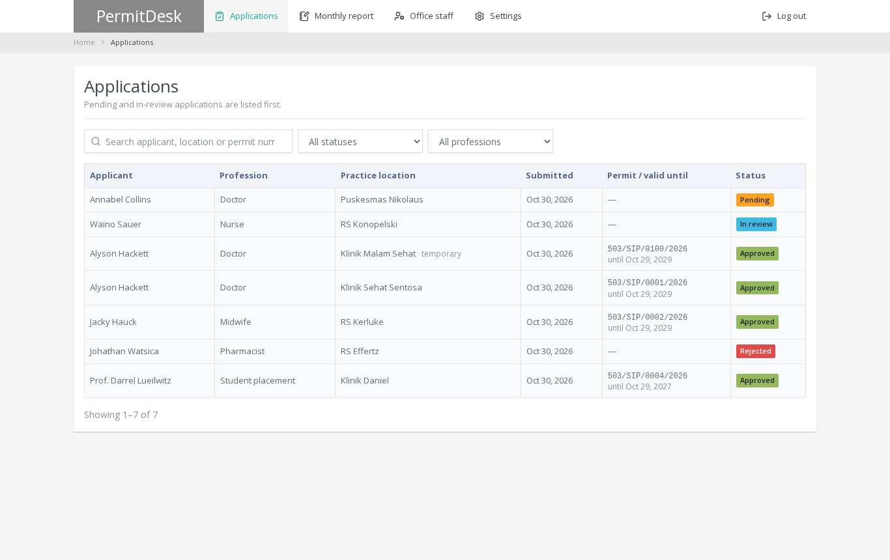
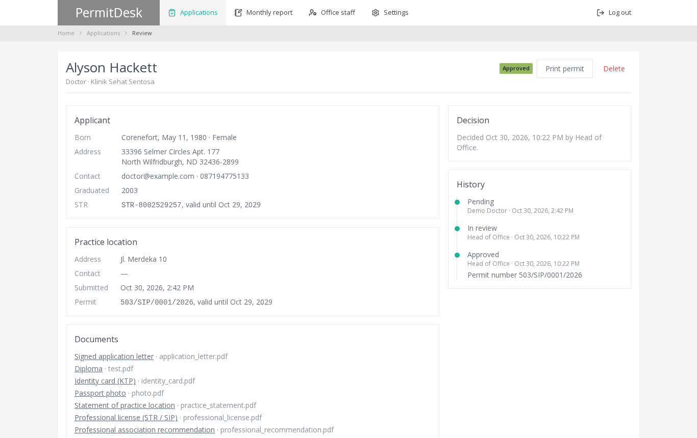
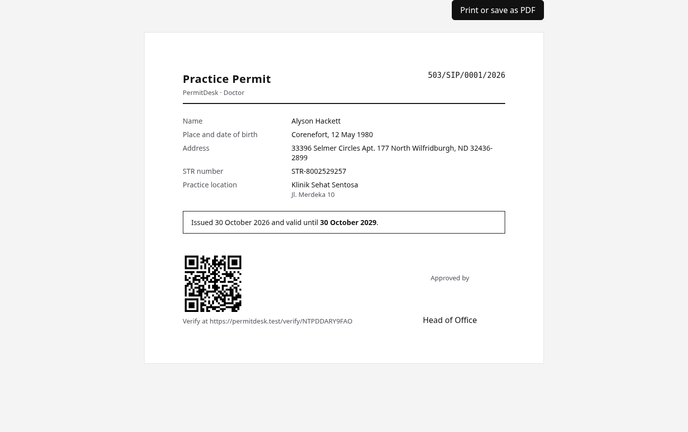
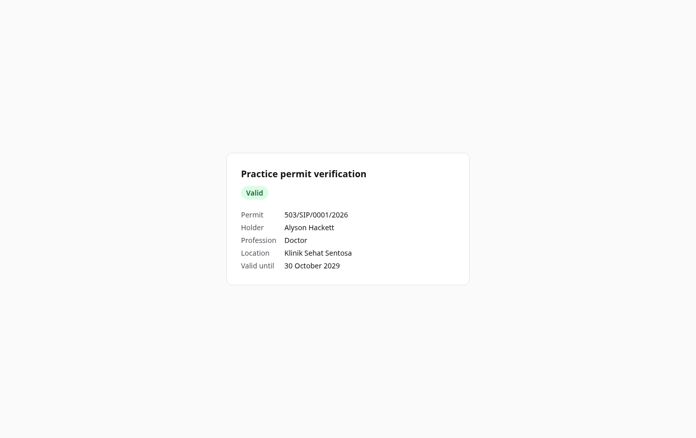
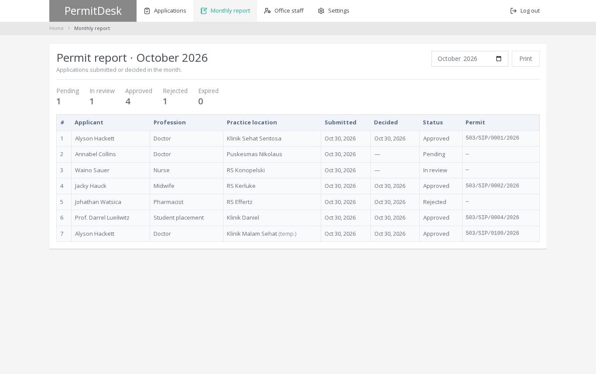
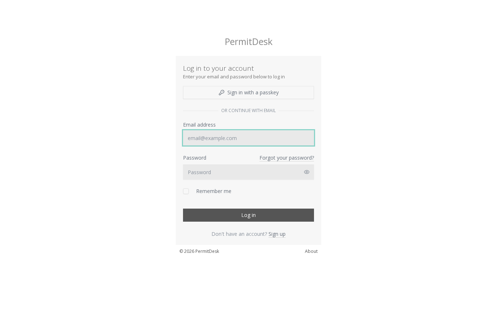

# PermitDesk

A practice-permit system for a regional licensing office. Doctors, nurses, midwives, pharmacists and student placements apply online. Office staff review the applications and issue printable permits that anyone can verify by QR code.

A from-scratch rewrite of a 2018 Laravel 5.5 project. No original client code or data is included.

## Screenshots

**Review queue**



**Application with documents and history**



**Printable permit with a verification QR code**



**Public verification page**



**Monthly report**



**Sign-in**



## How it works

- **Applicants** register by profession, fill in their personal and licence details once, and upload the documents their profession requires. They then apply for one primary practice location and any number of temporary ones. An application can be edited or withdrawn until the office starts reviewing it.
- **Office staff** work a queue that lists pending and in-review applications first. Each application moves **Pending → In review → Approved or Rejected**, and an approved permit later moves to **Expired**.
    - The model refuses any other step.
    - It locks the row while deciding, so two reviewers cannot both decide the same application.
    - It records every change in an append-only history.
- **Approval** needs a unique permit number. The permit is valid until the applicant's professional licence (STR/SIP) expires, or for one year for student placements. A permit cannot be issued against a licence that has already expired.
- **Permits** print from a browser view. Each carries a QR code pointing to `/verify/{code}`, a public page that confirms whether the permit is genuine and still valid.
- **Scheduler:** `permits:expire` marks lapsed permits as expired every day. `permits:remind` emails each holder once, 30 days before their permit expires. Decisions are emailed to the applicant.
- **Head of office:** also sees a monthly report and manages office accounts.
- **Documents** are stored on the private disk and served only to their owner and office staff.

## Design

The interface follows the original's Atlant admin theme, rebuilt in Tailwind: a white top menu with a grey name block, a breadcrumb strip, a large page title and white panels on a light grey page, Open Sans type, and a confirmation box before signing out. Status labels keep Atlant's colours with dark text where white would be hard to read. Light theme only, as the original was.

## Stack

Laravel 13 · PHP 8.4 · Inertia 3 + Vue 3 + TypeScript · Tailwind 4 · Fortify (email verification, passkeys, 2FA) · queued mail notifications · PHPUnit · Larastan level 7

## Development

```bash
composer run setup
php artisan migrate:fresh --seed
composer run dev
```

Demo sign-ins (password `password`):

| Email                | Role                                          |
| -------------------- | --------------------------------------------- |
| `head@example.com`   | Head of office                                |
| `staff@example.com`  | Licensing staff                               |
| `doctor@example.com` | Applicant (doctor) with a pending application |

The seeder also creates applicants of every profession, with applications at each stage.

```bash
php artisan test
composer run types:check   # Larastan
npm run check && npm run types:check
```
